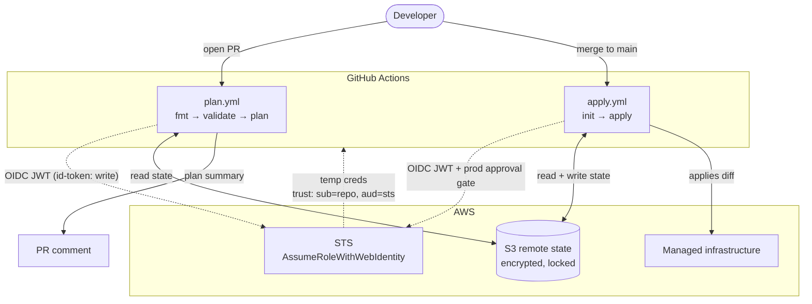

# iac-cicd — GitOps CI/CD for Terraform on AWS

Keyless and gated. Git is the source of truth: changes are **proposed** in a PR (plan-only) and **applied** on merge (after manual approval). No manual `terraform apply`, no long-lived AWS credentials.

## Features

- **Keyless auth**: GitHub Actions authenticates to AWS via OIDC, exchanging a short-lived token for temporary STS credentials per run.
- **GitOps loop**: `plan` on PR, `apply` on merge. A PR only previews the diff; it never touches AWS.
- **Gated apply**: merges to `main` pass through a protected `prod` environment with required manual approval.
- **Remote state with native locking**: S3 backend, encrypted and versioned, using Terraform's native S3 locking (`use_lockfile`).
- **Least-privilege IAM**: the CI role is scoped to specific SSM and S3 state ARNs, not `*`.

## Architecture



Design rationale (OIDC auth, the bootstrap/app split, the plan/apply split, the approval gate) is recorded in [docs/adr/](docs/adr/).

## Repository layout

```
bootstrap/            one-time setup, applied locally
  main.tf             OIDC provider + IAM role + S3 state bucket
app/                  example workload the pipeline manages (swap for real infra)
  main.tf             SSM parameter, a minimal free resource that produces plan diffs
.github/workflows/
  plan.yml            PR: fmt → validate → plan → comment
  apply.yml           merge to main: init → apply (prod-gated)
backend.hcl.example   backend config template (real backend.hcl is gitignored)
```

- `bootstrap/` and `app/` use **separate state keys** in one bucket, so state never collides.
- `bootstrap/` runs once before CI: the IAM role and state bucket must exist before workflows can assume the role.

## Quickstart

1. **Bootstrap (once, locally):** create the OIDC provider, IAM role, and state bucket.

   ```bash
   cd bootstrap
   terraform init -backend-config=backend.hcl   # copy from backend.hcl.example first
   terraform apply
   ```

2. **Configure repo variables** (Settings → Secrets and variables → Actions → Variables):
   `AWS_ROLE_ARN`, `AWS_REGION`, `TF_STATE_BUCKET`, `TF_STATE_KEY`, all from the bootstrap outputs.
3. **Add a `prod` environment** (Settings → Environments) with a required reviewer to gate applies.
4. **Open a PR** touching `app/` → `plan.yml` posts the plan as a comment.
5. **Merge** → `apply.yml` waits for approval, then applies.

## Known limitations

- **Broad OIDC trust `sub`**:
  - Current: allows any ref (`repo:owner/iac-cicd:*`).
  - Ideal: allows only main (`repo:owner/iac-cicd:refs/heads/main`).
- **Unscoped SSM read**:
  - Current: `ssm:Get*`/`Describe*`/`List*` granted on `*`.
  - Ideal: scope read actions to the single managed parameter ARN.
- **No automated policy checks**:
  - Current: only a human reading the plan reviews changes.
  - Ideal: tflint and a security scanner (checkov/tfsec) in the plan job fail the PR on misconfigurations and IAM over-permissions.
- **Shared plan/apply credentials**:
  - Current: one role used for both PR plans and merge applies.
  - Ideal: a read-only role for PR plans, a write role only for the gated apply path.
